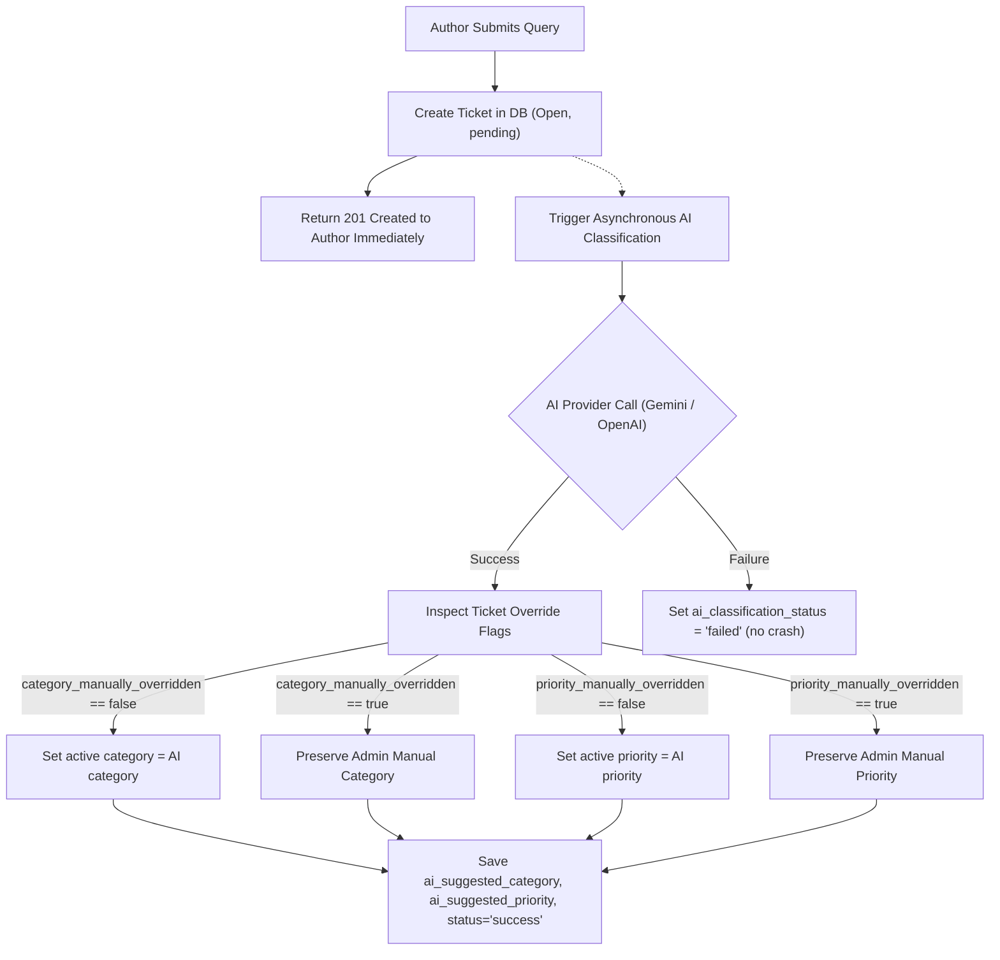

# BookLeaf Author Support Portal — Architecture

## 1. Project Overview

- **Author Portal:** Authors log in to view their profile, books, royalties, raise support tickets and track ticket conversations and status.
- **Admin Portal:** Admins manage all tickets — assign them, update status/category/priority, add private internal notes and respond to authors.
- **AI Assistance:** Automatically classify tickets and suggest priority on creation. Generate draft replies for admins on demand. AI-generated replies are never sent automatically — an admin must review and approve before sending.

## 2. Technology Stack

| Layer | Technology |
|---|---|
| Frontend | React + TypeScript + Vite |
| Styling | Tailwind CSS + shadcn/ui |
| Backend | Node.js + Express + TypeScript |
| Database | PostgreSQL (Neon) |
| ORM | Sequelize |
| Authentication | JWT + bcrypt |
| Validation | Zod |
| Forms | React Hook Form |
| Icons | Lucide React |
| AI/LLM | Google Gemini and OpenAI through an environment-configured provider manager |

## 3. Repository Structure

Single monorepo with npm workspaces:

```
bookleaf/
├── apps/
│   ├── web/            # Single React app (author + admin portals)
│   └── api/            # Express backend
├── packages/
│   └── shared/         # Shared TypeScript types and Zod schemas
├── package.json        # Workspace root
├── .gitignore
├── .env.example
├── ARCHITECTURE.md
└── README.md
```

- One React application serves both portals using role-based routes and layouts (`/author/*`, `/admin/*`).
- One Express API serves all endpoints.
- Shared types and validation schemas live in `packages/shared/`.

## 4. Backend Architecture

Modular MVC/service structure:

```
api/src/
├── config/             # Database connection, environment variables
├── models/             # Sequelize models and associations
├── modules/
│   ├── auth/           # Login, JWT, password verification
│   ├── authors/        # Author profile, books
│   ├── tickets/        # Ticket CRUD, messages, internal notes
│   └── ai/             # Classification, priority, draft responses
├── middleware/          # authenticate, authorize, validate, errorHandler
├── utils/              # Shared helpers (API response format, etc.)
├── app.ts              # Express app setup
└── server.ts           # Server entry point
```

Each module contains its own routes, controller and service files.

**Responsibilities:**

- **Routes:** Define endpoints, attach middleware.
- **Controllers:** Parse requests, call services, send responses.
- **Services:** Business logic, database queries, AI calls.
- **Models:** Sequelize model definitions and associations.
- **Middleware:** JWT verification, role checks, Zod validation, global error handling.

**Not using:** Repository pattern, DTO classes, microservices, separate AI gateway.

## 5. Database Design

### Tables & Schema Specifications

#### 1. `users`
Represents all system users (both authors and administrative staff).

| Column | Type | Constraints / Defaults | Description |
|---|---|---|---|
| `id` | INTEGER | PRIMARY KEY, AUTO_INCREMENT | Internal primary key |
| `author_id` | VARCHAR(50) | UNIQUE, NULLABLE | Business identifier (e.g. `AUTH001`), null for admins |
| `role` | VARCHAR(20) | NOT NULL, CHECK (`role` IN ('author', 'admin')) | User role |
| `name` | VARCHAR(255) | NOT NULL | Full name of author or administrator |
| `email` | VARCHAR(255) | NOT NULL, UNIQUE | Login email address |
| `password_hash` | VARCHAR(255) | NOT NULL | Bcrypt-hashed password |
| `phone` | VARCHAR(50) | NULLABLE | Contact telephone number |
| `city` | VARCHAR(100) | NULLABLE | City of residence |
| `joined_date` | DATE | NULLABLE | Date joined BookLeaf |
| `created_at` | TIMESTAMPTZ | NOT NULL, DEFAULT NOW() | Record creation timestamp |
| `updated_at` | TIMESTAMPTZ | NOT NULL, DEFAULT NOW() | Record last update timestamp |

#### 2. `books`
Contains book catalog information associated with authors, preserving all fields from the source dataset.

| Column | Type | Constraints / Defaults | Description |
|---|---|---|---|
| `id` | INTEGER | PRIMARY KEY, AUTO_INCREMENT | Internal primary key |
| `book_id` | VARCHAR(50) | NOT NULL, UNIQUE | Business identifier (e.g. `BK001`) |
| `author_user_id` | INTEGER | NOT NULL, FK → `users(id)` ON DELETE CASCADE | Foreign key linking book to author |
| `title` | VARCHAR(255) | NOT NULL | Title of the book |
| `isbn` | VARCHAR(50) | NOT NULL, UNIQUE | International Standard Book Number |
| `genre` | VARCHAR(100) | NOT NULL | Literary genre |
| `publication_date` | DATE | NULLABLE | Publication date (null if still in production) |
| `status` | VARCHAR(100) | NOT NULL | Production/live status |
| `mrp` | DECIMAL(10, 2) | NULLABLE | Maximum Retail Price in INR (null if unpriced) |
| `author_royalty_per_copy` | DECIMAL(10, 2) | NULLABLE | Royalty amount per copy sold |
| `total_copies_sold` | INTEGER | NOT NULL, DEFAULT 0 | Cumulative units sold across all channels |
| `total_royalty_earned` | DECIMAL(12, 2) | NOT NULL, DEFAULT 0 | Total accrued royalty earnings |
| `royalty_paid` | DECIMAL(12, 2) | NOT NULL, DEFAULT 0 | Total royalty payouts disbursed |
| `royalty_pending` | DECIMAL(12, 2) | NOT NULL, DEFAULT 0 | Unpaid royalty balance |
| `last_royalty_payout_date` | DATE | NULLABLE | Date of most recent payout transaction |
| `print_partner` | VARCHAR(100) | NULLABLE | Print vendor (e.g. 'In-House', 'Repro India') |
| `available_on` | TEXT[] | NOT NULL, DEFAULT '{}' | Channels listing the book |
| `created_at` | TIMESTAMPTZ | NOT NULL, DEFAULT NOW() | Record creation timestamp |
| `updated_at` | TIMESTAMPTZ | NOT NULL, DEFAULT NOW() | Record last update timestamp |

#### 3. `tickets`
Support tickets raised by authors with AI classification, priority scoring, and draft response tracking.

| Column | Type | Constraints / Defaults | Description |
|---|---|---|---|
| `id` | INTEGER | PRIMARY KEY, AUTO_INCREMENT | Internal primary key |
| `ticket_number` | VARCHAR(50) | NOT NULL, UNIQUE | Human-readable ticket reference (e.g. `TICK-1001`) |
| `author_user_id` | INTEGER | NOT NULL, FK → `users(id)` ON DELETE CASCADE | Author who submitted the ticket |
| `book_id` | INTEGER | NULLABLE, FK → `books(id)` ON DELETE SET NULL | Associated book (null for general query) |
| `assigned_to` | INTEGER | NULLABLE, FK → `users(id)` ON DELETE SET NULL | Assigned administrator user ID |
| `subject` | VARCHAR(255) | NOT NULL | Summary line of query |
| `description` | TEXT | NOT NULL | Detailed inquiry description |
| `category` | VARCHAR(100) | NOT NULL, DEFAULT 'General Inquiry' | Active category (assignment values) |
| `priority` | VARCHAR(20) | NOT NULL, DEFAULT 'Medium' | Active priority ('Critical', 'High', 'Medium', 'Low') |
| `status` | VARCHAR(30) | NOT NULL, DEFAULT 'Open' | Active status ('Open', 'In Progress', 'Resolved', 'Closed') |
| `ai_suggested_category` | VARCHAR(100) | NULLABLE | Original category suggested by AI |
| `ai_suggested_priority` | VARCHAR(20) | NULLABLE | Original priority suggested by AI |
| `ai_classification_status` | VARCHAR(30) | NOT NULL, DEFAULT 'pending' | Status: `pending`, `success`, `failed`, `manual_override` |
| `ai_suggested_reply` | TEXT | NULLABLE | Original AI-generated draft response |
| `ai_reply_edited_draft` | TEXT | NULLABLE | Editable draft buffer for admin modifications |
| `ai_draft_generated_at` | TIMESTAMPTZ | NULLABLE | Timestamp when AI response was drafted |
| `created_at` | TIMESTAMPTZ | NOT NULL, DEFAULT NOW() | Ticket creation timestamp |
| `updated_at` | TIMESTAMPTZ | NOT NULL, DEFAULT NOW() | Ticket last update timestamp |

#### 4. `ticket_messages`
Immutable conversation stream between authors and admin staff on a support ticket.

| Column | Type | Constraints / Defaults | Description |
|---|---|---|---|
| `id` | INTEGER | PRIMARY KEY, AUTO_INCREMENT | Internal primary key |
| `ticket_id` | INTEGER | NOT NULL, FK → `tickets(id)` ON DELETE CASCADE | Parent ticket reference |
| `sender_id` | INTEGER | NOT NULL, FK → `users(id)` ON DELETE CASCADE | Sender user ID (author or admin) |
| `message` | TEXT | NOT NULL | Message body |
| `is_ai_assisted` | BOOLEAN | NOT NULL, DEFAULT false | Whether message originated from or was assisted by AI |
| `created_at` | TIMESTAMPTZ | NOT NULL, DEFAULT NOW() | Message timestamp (immutable record; no updated_at) |

#### 5. `ticket_internal_notes`
Immutable private notes authored by administrators, strictly isolated from author views.

| Column | Type | Constraints / Defaults | Description |
|---|---|---|---|
| `id` | INTEGER | PRIMARY KEY, AUTO_INCREMENT | Internal primary key |
| `ticket_id` | INTEGER | NOT NULL, FK → `tickets(id)` ON DELETE CASCADE | Parent ticket reference |
| `admin_id` | INTEGER | NOT NULL, FK → `users(id)` ON DELETE CASCADE | Authoring administrator user ID |
| `note` | TEXT | NOT NULL | Internal staff note content |
| `created_at` | TIMESTAMPTZ | NOT NULL, DEFAULT NOW() | Note creation timestamp (immutable record; no updated_at) |

### Key Design Decisions & Business Integrity Rules

- **Primary keys:** Auto-increment integers for all tables for clean relational joins and foreign key performance.
- **Single `users` table** with `role` check constraint (`author` | `admin`). Author-specific attributes (`author_id`, `phone`, `city`, `joined_date`) are nullable for administrators.
- **Business IDs preserved:** `author_id` (e.g. `AUTH001`), `book_id` (e.g. `BK001`), and `ticket_number` (e.g. `TICK-1001`) are unique columns separate from surrogate integer keys.
- **Full JSON data fidelity:** All 14 book fields and all 5 author fields from the source dataset are captured without alteration or data loss.
- **Decimals for currencies:** Financial values (`mrp`, `author_royalty_per_copy`, `total_royalty_earned`, `royalty_paid`, `royalty_pending`) use `DECIMAL` types to eliminate binary floating-point rounding errors.
- **PostgreSQL text array (`TEXT[]`):** `books.available_on` uses native PostgreSQL arrays with no join table overhead.
- **Ticket book ownership validation:** When creating a ticket linked to a `book_id`, service logic enforces that `book.author_user_id === ticket.author_user_id`. General queries leave `book_id` as `NULL`.
- **Admin assignment validation:** Service logic verifies that `tickets.assigned_to` corresponds to an account with `role = 'admin'`.
- **AI suggestion isolation:** Active values (`category`, `priority`) remain distinct from AI recommendations (`ai_suggested_category`, `ai_suggested_priority`). The original draft (`ai_suggested_reply`) and the editable working copy (`ai_reply_edited_draft`) are preserved separately.
- **Internal notes isolation:** `ticket_internal_notes` is an isolated table and is never returned in author-facing API responses or serializers.
- **Immutable audit trails:** `ticket_messages` and `ticket_internal_notes` only maintain `created_at` to reflect append-only history.
- **Safe royalty constraints:** No database CHECK constraint enforces calculated royalty equality (`earned = paid + pending`) to avoid rejecting real-world production or partial-settlement records.

### Allowed Values & Constraints

- **Ticket Categories:**
  `'Royalty & Payments'`, `'ISBN & Metadata Issues'`, `'Printing & Quality'`, `'Distribution & Availability'`, `'Book Status & Production Updates'`, `'General Inquiry'`
- **Ticket Priorities:**
  `'Critical'`, `'High'`, `'Medium'`, `'Low'`
- **Ticket Statuses:**
  `'Open'`, `'In Progress'`, `'Resolved'`, `'Closed'`
- **AI Classification Statuses:**
  `'pending'`, `'success'`, `'failed'`, `'manual_override'`

### Model Associations & Aliases

```
User.hasMany(Book, { foreignKey: 'author_user_id', as: 'books' })
Book.belongsTo(User, { foreignKey: 'author_user_id', as: 'author' })

User.hasMany(Ticket, { foreignKey: 'author_user_id', as: 'raisedTickets' })
Ticket.belongsTo(User, { foreignKey: 'author_user_id', as: 'author' })

User.hasMany(Ticket, { foreignKey: 'assigned_to', as: 'assignedTickets' })
Ticket.belongsTo(User, { foreignKey: 'assigned_to', as: 'assignedAdmin' })

Book.hasMany(Ticket, { foreignKey: 'book_id', as: 'tickets' })
Ticket.belongsTo(Book, { foreignKey: 'book_id', as: 'book' })

Ticket.hasMany(TicketMessage, { foreignKey: 'ticket_id', as: 'messages' })
TicketMessage.belongsTo(Ticket, { foreignKey: 'ticket_id', as: 'ticket' })

Ticket.hasMany(TicketInternalNote, { foreignKey: 'ticket_id', as: 'internalNotes' })
TicketInternalNote.belongsTo(Ticket, { foreignKey: 'ticket_id', as: 'ticket' })

TicketMessage.belongsTo(User, { foreignKey: 'sender_id', as: 'sender' })
User.hasMany(TicketMessage, { foreignKey: 'sender_id', as: 'sentMessages' })

TicketInternalNote.belongsTo(User, { foreignKey: 'admin_id', as: 'admin' })
User.hasMany(TicketInternalNote, { foreignKey: 'admin_id', as: 'internalNotes' })
```

### Database Indexes

- `users(email)` — UNIQUE
- `users(author_id)` — UNIQUE
- `books(book_id)` — UNIQUE
- `books(isbn)` — UNIQUE
- `books(author_user_id)` — Foreign key lookup
- `tickets(ticket_number)` — UNIQUE
- `tickets(author_user_id)` — Author ticket lookups
- `tickets(assigned_to)` — Admin assignment queue lookups
- `tickets(status)` — Status filtering
- `tickets(priority)` — Priority sorting/filtering
- `tickets(created_at)` — Chronological sorting
- `ticket_messages(ticket_id)` — Ticket message retrieval
- `ticket_internal_notes(ticket_id)` — Ticket notes retrieval

## 6. Authentication & Authorization

- **Login:** Email + password. JWT issued on success.
- **JWT payload:** User ID, role, email.
- **Middleware:** `authenticate` verifies the JWT on all protected routes. `authorize(role)` restricts endpoints by role.
- **Author isolation:** Every author-scoped query filters by the authenticated user's ID. An author cannot access another author's tickets, books or data.
- **Admin access:** Admins can access all tickets, messages and internal notes.
- **Token storage:** JWT stored in an HTTP-only cookie. Requires appropriate CORS configuration (credentials, allowed origins), secure cookie settings (HttpOnly, SameSite, Secure in production) and CSRF protection.
- **Refresh tokens:** Not implementing. Single access token via HTTP-only cookie is sufficient for this scope.

## 7. AI Integration & Intelligent Assistance Architecture

### Core Design Principles
1. **Never Block Operations:** Ticket creation, ticket updates, manual replies, and ticket queries NEVER wait on or fail because of AI provider availability. Classification runs asynchronously in the background.
2. **Provider Redundancy & Resilient Fallback:** Dual-provider architecture supporting Google Gemini (`gemini-3.8-flash`) and OpenAI (`gpt-4o-mini`). If the primary provider experiences rate limiting (429), timeouts, or service unavailability (5xx), the system automatically falls back to the secondary provider without data loss.
3. **Traceability & Granular Admin Overrides:** When AI classification succeeds, it sets the ticket's initial active `category` and `priority` to organize the queue immediately, while storing original suggestions in `ai_suggested_category` and `ai_suggested_priority`. Admins can independently override either field. Late-arriving AI classifications will never overwrite an admin's manual choice.
4. **Knowledge Base Grounding (Anti-Hallucination):** The official BookLeaf Knowledge Base is dynamically retrieved based on effective category and inquiry keywords. Prompts strictly forbid inventing payment transaction IDs, assuming unexecuted actions, or fabricating arbitrary calendar dates.
5. **Strict SLA Calibration:** The 48-hour timeline is used only for the assignment's specified cases: genuinely overdue royalty escalation, ISBN errors, and platform stock re-syncs. Physical reprints follow 5–7 business days, metadata updates 3–5 business days, and new listings 7–10 business days.
6. **Strict Security Isolation:** Internal notes (`ticket_internal_notes`) are strictly confidential and are NEVER included in AI prompts or exposed to author portals.
7. **Human-in-the-Loop:** AI draft replies are generated on demand for administrative staff to review and edit. Drafts are never sent automatically.

### AI Capabilities Matrix

| Function | Trigger | Input Context | Output | Resilience / Fallback |
|---|---|---|---|---|
| **Ticket Auto-Classification** | Asynchronous upon ticket creation | Subject, description | Active category & priority + suggested fields | Fallback to secondary provider; on complete failure defaults to `General Inquiry` / `Medium` with status `failed` |
| **AI Reply Draft Generation** | On-demand admin action | Subject, description, effective category, linked book data, public messages, relevant KB sections | Clean, ready-to-review reply draft string | Returns `{ status: 'unavailable' }` gracefully if providers fail; never disrupts ticket operations |

### Provider Configuration & Model Justification

- **Default Primary Provider: OpenAI (`gpt-4o-mini`)**
  - Selected in `.env.example` as a cost-conscious model for short structured classifications and support drafts.
  - Uses JSON response mode for classification and schema validation before results are persisted.
- **Configured Fallback: Google Gemini (`gemini-3.8-flash`)**
  - Provides a second independent provider so transient provider failures do not stop classification or reply drafting.
  - Provider order is configurable through `AI_PRIMARY_PROVIDER` and `AI_FALLBACK_PROVIDERS`; deployments can choose either provider first.

### Classification & Override Lifecycle



### Calibrated Priority Levels

- **Critical:** Complete blockage of publication or revenue causing immediate severe harm, such as a catastrophic launch failure or platform-wide outage.
- **High:** Significant operational issues affecting author revenue or book delivery requiring urgent human intervention. ISBN errors are High priority under the supplied Knowledge Base, as are genuinely overdue royalty payouts and significant printing or distribution issues.
- **Medium:** Standard operational support requests, routine status inquiries, or metadata update requests. The assignment does not define a general production turnaround window, so the system does not assume one. *A self-service workaround is not required for Medium priority.*
- **Low:** General informational inquiries, publishing advice, feedback, or non-blocking questions.

## 8. Real-Time Updates

- Uses **polling every 15 seconds** on author and admin ticket detail pages.
- This satisfies the assignment's real-time or near-real-time requirement without adding WebSocket infrastructure.
- SSE or WebSockets could be considered if future traffic patterns justify them.

## 9. API Documentation

- Document all endpoints in the **README** with method, path, auth requirements and description.
- No Swagger setup initially. Add only if time permits after core functionality is complete.

## 10. Scope Boundaries

### In scope

- Author login, profile, books, royalties display.
- Full ticket lifecycle: create → classify → assign → respond → resolve/close.
- AI classification, priority suggestion and draft response generation.
- Admin ticket queue with filtering by status, category, priority, date.
- Internal notes (admin-only).
- Polling-based ticket updates.
- Seed script loading the provided JSON dataset.
- README documentation.

### Out of scope

- Redis, message queues, Kubernetes, Docker (for development).
- Vector databases, embeddings, RAG pipelines.
- Microservices or separate AI gateway.
- Refresh tokens or complex session management.
- File upload (UI placeholder only — actual upload is bonus per the assignment).
- Social login, OTP, OAuth.

---

## Decisions & Implementations

| Area | Decision | Details |
|---|---|---|
| AI Primary Provider (default) | OpenAI (`gpt-4o-mini`) | Cost-conscious model for structured classification and concise support drafts |
| AI Fallback Provider (default) | Google Gemini (`gemini-3.8-flash`) | Independent fallback provider; order is environment-configurable |
| Deployment Targets | Vercel (Frontend) + Render (Backend) | Free-tier compatible, decoupled scaling with PostgreSQL (Neon) |


## 11. AI Provider and Prompt Context Decisions

The implementation uses an environment-configured provider chain. The primary provider is selected with `AI_PRIMARY_PROVIDER`; `AI_FALLBACK_PROVIDERS` defines the ordered fallback list. The supplied environment template selects OpenAI (`gpt-4o-mini`) first and Gemini (`gemini-3.8-flash`) as fallback. API keys are read only by the backend from environment variables and are never sent to the browser.

Ticket classification is triggered after the ticket transaction commits, so an AI outage does not block ticket submission. Provider adapters normalize failures and the provider manager attempts the configured chain. Reply drafts are generated only when requested by an admin and must be reviewed before sending. Private internal notes are excluded from the draft context.

Reply generation uses category- and keyword-based Knowledge Base section selection. It also bounds conversation history to the 15 most recent public messages, a 12,000-character aggregate conversation budget and a 3,000-character per-message limit. The original ticket details and linked-book facts remain in the prompt. The Knowledge Base follows the assignment PDF; no quarter-end calendar dates are assumed because the PDF specifies quarterly calculation and payment within 45 days after quarter end but does not list calendar dates.
